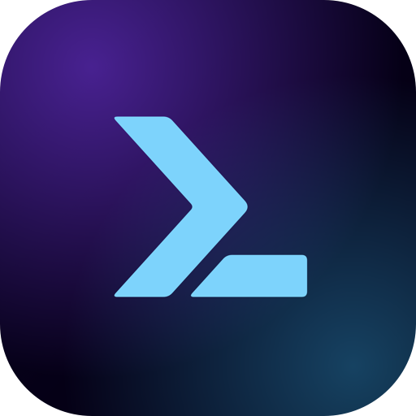

  &nbsp;&nbsp;
  

<h1 align="center">sophonz labs</h1>

Frontend-first, self-healing observability, and an ADE for coding agents on your terminal, from anywhere.

## What we build

 **sophonz observability** — Frontend-first Observability, AI auto-fixes real-user problems.
An OpenTelemetry-native platform at [sophonz.com](https://sophonz.com) that collects every signal from frontend to backend,
straight from the real users of your deployed app, and lets Sophonz AI pinpoint root causes and suggest the fix: self-healing
for the problems your users actually hit. SDKs for Android, iOS, web, React Native, Flutter and Python. The collector is a fork of
[opentelemetry-collector-contrib](https://github.com/sophonz-labs/opentelemetry-collector-contrib).

 **sophonz terminal (`st`)** — your terminal & ADE, on the go.
An agentic development environment built on your terminal multiplexer. Run Claude Code, Codex, Gemini CLI or opencode
on your machine, let one agent hand work to others, even on other machines, and watch and answer from the desktop app,
your phone or any browser. No SSH client, no port forwarding, no key on your phone. Site: [sophonz.io](https://sophonz.io). Install from [dl.sophonz.io](https://dl.sophonz.io) or the [Homebrew tap](https://github.com/sophonz-labs/homebrew-tap).

## Open source

| Repository | What it is |
|---|---|
| [stui](https://github.com/sophonz-labs/stui) | Terminal UI for tmux and the coding agents in it: agent state, orchestration and GitHub Actions |
| [tmui](https://github.com/sophonz-labs/tmui) | Terminal UI for tmux sessions, windows and panes |
| [tui-plugins](https://github.com/sophonz-labs/tui-plugins) | Plugins for tmui and stui: a CLI's output as a view, its commands on keys |
| [psmux](https://github.com/sophonz-labs/psmux) | tmux for Windows, in Rust: PowerShell, Windows Terminal, cmd.exe |
| [skills](https://github.com/sophonz-labs/skills) | Orchestration skills for Claude Code and Codex: one agent coordinates others in tmux through st |
| [homebrew-tap](https://github.com/sophonz-labs/homebrew-tap) | Homebrew formulae for sophonz tools |
| [opentelemetry-collector-contrib](https://github.com/sophonz-labs/opentelemetry-collector-contrib) | Our collector fork with the sophonz exporters and processors |
